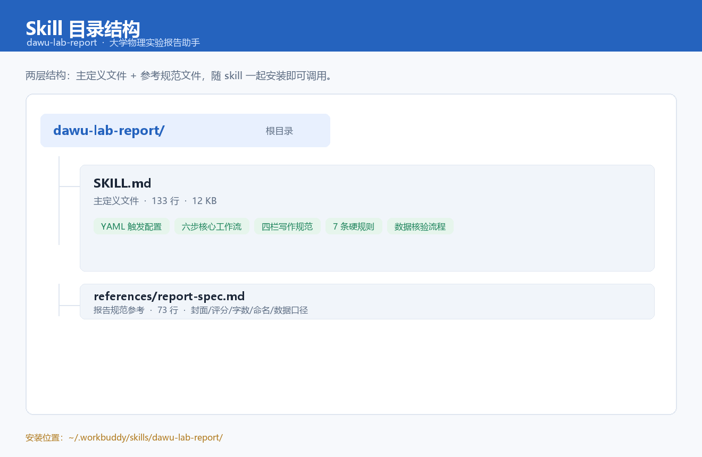
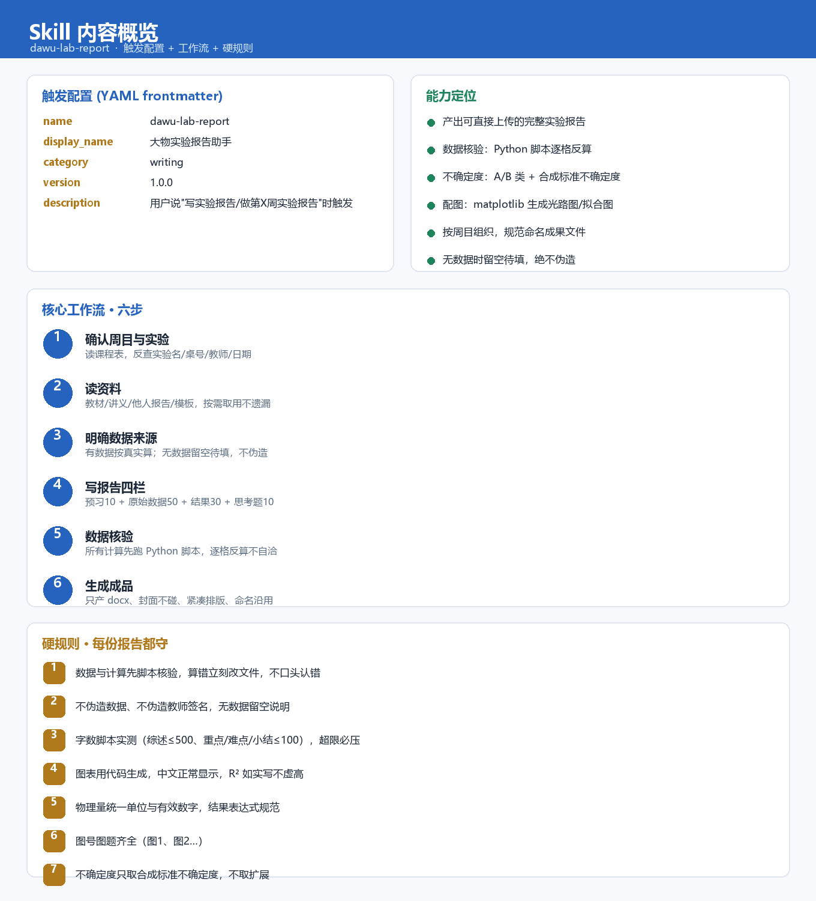
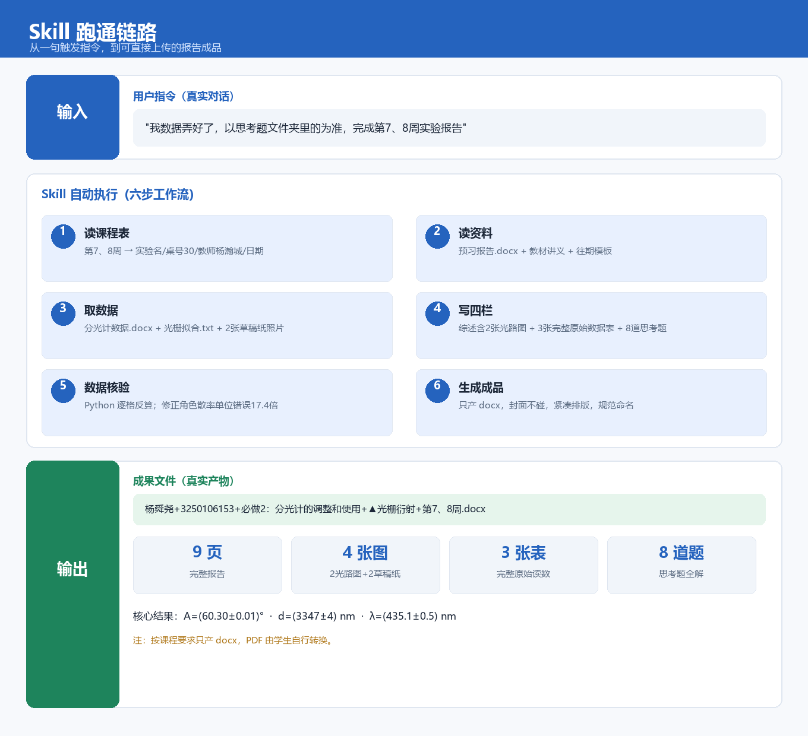
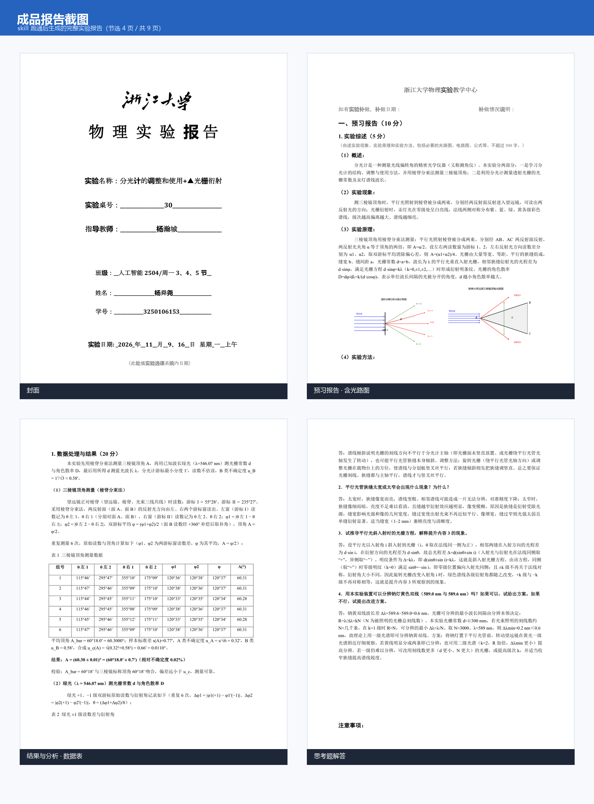

# 大物实验报告助手（dawu-lab-report）

面向浙江大学《大学物理实验》课程报告撰写场景的 AI 技能。

一句话触发，自动读取课程表、教材讲义、实验数据与草稿纸照片，生成结构完整、数据经过核验的实验报告正文，产出可直接上传的规范命名 docx 文件。

## 作品简介

本技能把一套依赖经验的报告撰写流程固化为可复用的自动能力。用户说"完成第X周实验报告"，技能即按课程表核对实验信息，读取教材、讲义、数据与草稿纸照片，自动生成覆盖预习报告、原始数据、结果与分析、误差分析、思考题四栏的完整报告。

技能内含六步工作流与七条硬规则：所有计算先用 Python 脚本逐格反算核验，不确定度按 A 类、B 类合成，无数据时留空待填而不伪造，只产出 docx 成品交由用户自行转换格式。针对反复出错的环节，如原始读数缺列、数据过于整齐、光路图漏拷、正文夹带批注等，均固化为强制检查项，随使用不断迭代。

产出为可直接上传的规范命名报告文件，把重复劳动沉淀为可交付的能力。

## 截图预览

### Skill 目录结构



### Skill 内容



### 跑通链路



### 成品报告



## 仓库内容

```
.
├── README.md                    本说明
├── dawu-lab-report/             skill 源文件
│   ├── SKILL.md                 主定义：触发配置、六步工作流、四栏规范、硬规则
│   ├── README.md                skill 说明
│   └── references/
│       └── report-spec.md       报告规范：封面、评分、字数、命名、数据口径
└── screenshots/                 四张作品截图
```

## 安装与使用

将 `dawu-lab-report/` 目录放入 WorkBuddy 技能目录 `~/.workbuddy/skills/` 下，然后在对话中说：

```
完成第7、8周实验报告
```

技能会自动执行六步流程并产出 docx 成品。

## 版本

1.0.0
